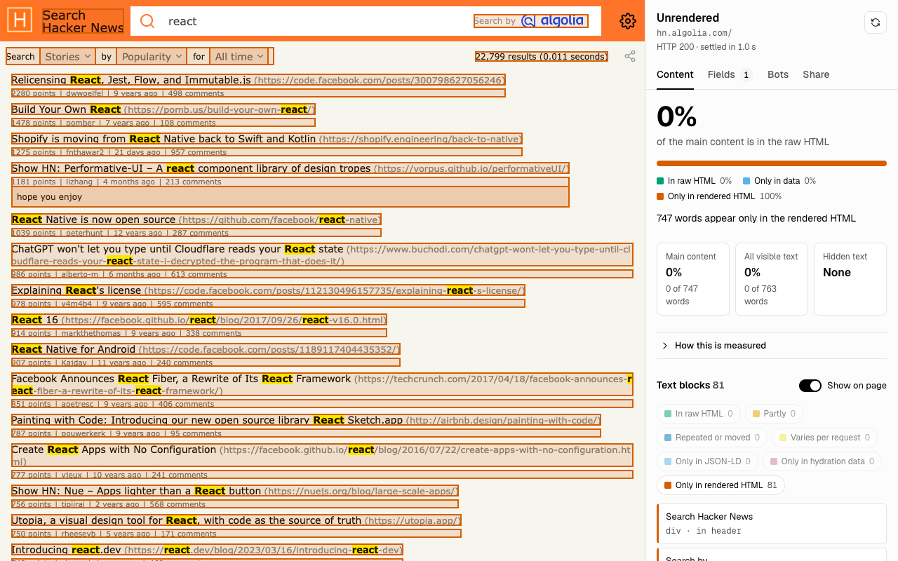
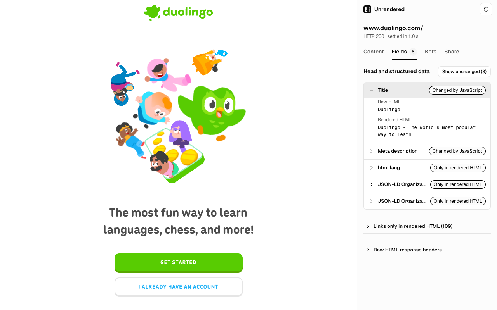
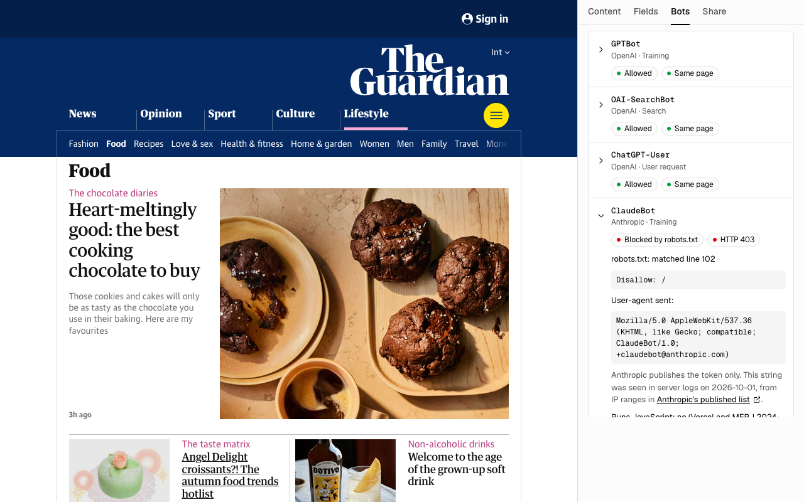

<div align="center">


# Unrendered: AI Crawler Checker (Chrome Extension + MCP Server)

**Check what AI crawlers like GPTBot and ClaudeBot can read on any page.**

Unrendered compares a page's raw HTML with its rendered HTML,<br>
so you can see which content only appears after JavaScript runs.

[](https://chromewebstore.google.com/detail/unrendered-ai-crawler-che/pboobaoffcajjmbeimkkkodfgpaopegm)
[](https://www.npmjs.com/package/unrendered-mcp)
[](LICENSE)

[Install](#install) · [MCP server](#mcp-server) · [How it measures](#how-it-measures) · [30-second demo](https://www.youtube.com/watch?v=3h2n3P3F1rU) · [Website](https://missiongrowth.io/tools/unrendered)



</div>

## Why

Vercel and MERJ measured AI crawler traffic in December 2024 and found that "none of the major AI crawlers currently render JavaScript" ([The rise of the AI crawler](https://vercel.com/blog/the-rise-of-the-ai-crawler)). A page can allow every bot in robots.txt and still send them an empty shell.

Unrendered shows that gap on the page itself: how much of the main content is in the raw HTML, and which text appears only after JavaScript runs.

## Install

### Chrome extension

[**Add to Chrome**](https://chromewebstore.google.com/detail/unrendered-ai-crawler-che/pboobaoffcajjmbeimkkkodfgpaopegm), open any page and click the icon. The side panel opens with the result.

### MCP server

Requires Node 20 or later and Google Chrome. No browser is downloaded.

[](https://cursor.com/en/install-mcp?name=unrendered&config=eyJjb21tYW5kIjoibnB4IiwiYXJncyI6WyIteSIsInVucmVuZGVyZWQtbWNwIl19)
[](https://insiders.vscode.dev/redirect?url=vscode%3Amcp%2Finstall%3F%257B%2522name%2522%253A%2522unrendered%2522%252C%2522command%2522%253A%2522npx%2522%252C%2522args%2522%253A%255B%2522-y%2522%252C%2522unrendered-mcp%2522%255D%257D)

Claude Code, as a plugin (the MCP server plus a skill that tells Claude when to use it):

```sh
claude plugin marketplace add imfurkana/unrendered-ai-crawler-checker-mcp
claude plugin install unrendered@unrendered
```

Or the MCP server alone:

```sh
claude mcp add unrendered -- npx -y unrendered-mcp
```

Claude Desktop and other clients that use the `mcpServers` format:

```json
{
  "mcpServers": {
    "unrendered": {
      "command": "npx",
      "args": ["-y", "unrendered-mcp"]
    }
  }
}
```

Then ask your assistant something like "Check which content on example.com/pricing AI crawlers can't see". Tools, output and options are in [mcp/README.md](mcp/README.md).

## What it shows

**Content.** The share of the main content that is in the raw HTML, and every text block with its state:

| State | Meaning |
| --- | --- |
| In raw HTML | This text is in the raw HTML. |
| Partly | Part of this text is in the raw HTML. JavaScript adds or changes the rest. |
| Repeated or moved | The same text is in the raw HTML, but not at this position. |
| Varies per request | Only one of two raw HTML requests had this text. |
| Only in JSON-LD | In the raw HTML this text exists only inside JSON-LD structured data. |
| Only in hydration data | In the raw HTML this text exists only inside framework data, such as `__NEXT_DATA__` or the RSC payload. |
| Only in rendered HTML | This text appears only after JavaScript runs. |

"Show on page" outlines each block on the page in its state's colour. Text that is in the raw HTML but gone from the rendered page is listed as "Only in raw HTML".

**Fields.** Title, meta description, canonical, hreflang, `html lang`, robots meta tags and JSON-LD, in the raw HTML and in the rendered HTML. It warns when the raw HTML says `noindex` and JavaScript removes it. It also lists links that exist only in the rendered HTML.

**Bots.** For 22 AI bot tokens: what robots.txt allows, and how the site answers a request with each bot's user-agent (same page, different page, challenge page, blocked, rate-limited or redirected). 17 are tested. Googlebot and Applebot run JavaScript and are not imitated. Google-Extended and Applebot-Extended never fetch pages. Claude-SearchBot has no verified user-agent string yet.

**Share.** A 1200 × 630 image, a one-line summary and a Markdown report.

<table>
  <tr>
    <td></td>
    <td></td>
  </tr>
</table>

## How it measures

1. After the click, the extension waits until the page has made no DOM changes for 1 s, for at most 8 s. Then it splits the rendered page into text blocks.
2. The same tab fetches the URL again: twice without cookies, as a crawler would, and once with your cookies.
3. Each rendered block is matched, in order, against the blocks of the first raw response. The second raw response separates text that changes on every request. The response with cookies is used only to tell you when the raw HTML has more text with your cookies.
4. Main content is the page's `<main>` element. Without one, it is all text outside the header, navigation, sidebars, footer and dialogs. Hidden text is counted on its own and is not part of the percentages.

Text is compared as words, so symbols such as ⌘ are not counted. The MCP server bundles the same snapshot and analysis code and runs it unchanged in a headless Chrome.

## Limits

- The extension is not a crawler. Requests come from your browser and your IP. Sites that verify bots by IP may answer the real bot differently.
- When the raw HTML is not the page (an error status, a challenge page from Cloudflare, AWS WAF or DataDome, or a redirect), no percentage is shown.
- Text inside iframes is not included.
- Raw HTML over 5 MB is cut at 5 MB.
- The page is measured at one width. The side panel narrows it, which can change what is hidden.
- Chrome does not let extensions read its own pages, the Chrome Web Store or PDFs.

## Build from source

You need Chrome 124 or later, Node.js and pnpm.

```sh
pnpm install
pnpm build
```

Open `chrome://extensions`, turn on Developer mode, click "Load unpacked" and choose the `dist` folder.

`pnpm check` runs the type check, lint, unit tests, build and the Playwright tests. The Playwright tests need Chromium once: `pnpm exec playwright install chromium`.

## Privacy

No data collection, no analytics, no storage. See [PRIVACY.md](PRIVACY.md).

## Licence

The code is licensed under the [GNU Affero General Public License v3.0](LICENSE). The names "Unrendered" and "Mission Growth" and their icons are not; see [TRADEMARK.md](TRADEMARK.md).

---

<div align="center">

Made by [Mission Growth](https://missiongrowth.io/tools/unrendered), an AI-led SEO and GEO growth service.

</div>
